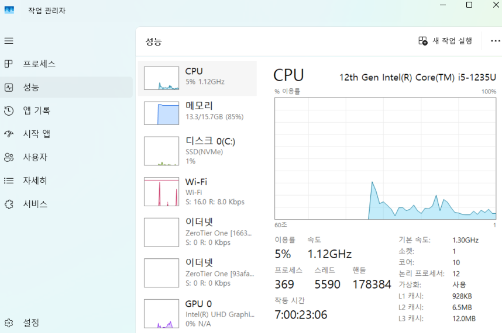
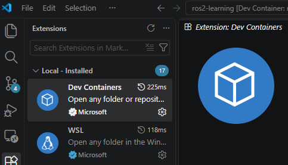
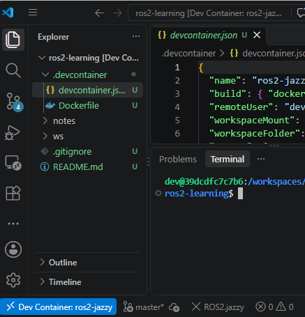

Windows(WSL2) 기반 환경 구축

목표 : VSCode에서 컨테이너 열고 `ros2 run turtlesim turtlesim_node`를 실행

1. 사전 점검
    
    
    | 항목 | 기준 |
    | --- | --- |
    | 디스크 여유 | 60GB 이상 (Docker 이미지와 이후 Gazebo용) |
    | RAM | 16GB 권장 (8GB는 Gazebo 단계에서 버거움) |
    | 가상화 | BIOS/UEFI에서 가상화(Intel VT-x, AMD-V)가 켜져 있어야 함 |
    | Windows | Windows 11 권장 (WSLg로 GUI 앱 지원). Windows 10은 버전과 설정에 따라 GUI가 안 될 수 있음 |
    
    가상환경 켜짐 확인 : 작업관리자 → 성능 → CPU → “가상화: 사용”
    
    
    
2. 호스트 환경 설치 
    1. WSL2 + Ubuntu 24.04 설치
        
        ```powershell
        # powershell 관리자 권한으로 실행
        wsl --install -d Ubuntu -24.04
        # 재부팅
        wsl --update
        wsl -l -v # version 2 확인
        ```
        
        ```bash
        # Ubutu 터미널 열어 기본 업데이트 & git curl 설치
        sudo apt update && sudo apt upgrade -y
        sudo apt install -y git curl
        ```
        
    2. Docker 설치(2가지중 선택)
        1. Docker Desktop 설치(권장)
            1. Microsoft store 통해 설치
        2. WSL에 Docker Engine 설치
            1. Docker 공식 문서 “Install Docker Engine on Ubuntu” 참고, 이후 아래 실행 
            
            ```bash
            sudo usermod -aG docker $USER   # 터미널 재시작 후 적용
            ```
            
    3. VSCode 설치
        
        
        
        1. Microsoft store에서 설치
        2. 설치 후 확장 설치 : WSL, Dev Containers
        3. 테스트 : Ubuntu 터미널에서 `code .` 실행 후 실행 확인
3. 프로젝트 폴더 & git
    1. 반드시 WSL 내부 경로에 만들어야 함, Windows 드라이브(`/mnt/c/…`)에 두면 I/O가 매우 느려 빌드 시간이 크게 늘어남 
        
        ```bash
        git config --global user.name "이름"
        git config --global user.email "이메일"
        
        mkdir -p ~/ros2-learning/.devcontainer ~/ros2-learning/ws/src ~/ros2-learning/notes
        cd ~/ros2-learning
        git init
        ```
        
    2. 권장 폴더 구조
        
        ros2-learning/
        ├─ .devcontainer/
        │  ├─ Dockerfile
        │  └─ devcontainer.json
        ├─ ws/src/            # ROS 2 워크스페이스 (3주차부터 사용)
        ├─ notes/             # 주차별 학습 메모 (week01.md ...)
        ├─ .gitignore
        └─ README.md
        
    3. `.gitignore` 
        
        ws/build/
        ws/install/
        ws/log/
        **pycache**/
        
    4. GitHub 저장소 생성 후 연결 : `ros2-learning`
4. Dev Container
    1. .devcontainer/Dockerfile 
        
        ```docker
        FROM osrf/ros:jazzy-desktop
        
        # 개발 도구
        RUN apt-get update && apt-get install -y --no-install-recommends \
              sudo git nano bash-completion \
              ros-dev-tools \
              ros-jazzy-turtlesim \
              python3-pip \
            && rm -rf /var/lib/apt/lists/*
        
        # 일반 사용자(dev, UID 1000) 생성: 마운트한 폴더가 root 소유가 되는 것을 방지
        # (Ubuntu 24.04 기본 이미지에는 UID 1000 사용자가 이미 있을 수 있어 이름을 바꿔 사용)
        RUN if id -u 1000 >/dev/null 2>&1; then \
              OLD_USER=$(id -un 1000); OLD_GROUP=$(id -gn 1000); \
              usermod -l dev -d /home/dev -m "$OLD_USER" && groupmod -n dev "$OLD_GROUP"; \
            else \
              groupadd --gid 1000 dev && useradd --uid 1000 --gid 1000 -m -s /bin/bash dev; \
            fi \
         && echo "dev ALL=(ALL) NOPASSWD:ALL" > /etc/sudoers.d/dev \
         && chmod 0440 /etc/sudoers.d/dev
        
        USER dev
        
        # 셸 시작 시 ROS 2 환경 자동 로드
        RUN echo "source /opt/ros/jazzy/setup.bash" >> /home/dev/.bashrc \
         && echo "[ -f /workspaces/ros2-learning/ws/install/setup.bash ] && source /workspaces/ros2-learning/ws/install/setup.bash" >> /home/dev/.bashrc
        
        WORKDIR /workspaces/ros2-learning
        ```
        
    2. .devcontainer/devcontainer.json(WSLgGui 연결 포함) 
        
        ```json
        {
          "name": "ros2-jazzy",
          "build": { "dockerfile": "Dockerfile" },
          "remoteUser": "dev",
          "workspaceMount": "source=${localWorkspaceFolder},target=/workspaces/ros2-learning,type=bind",
          "workspaceFolder": "/workspaces/ros2-learning",
          "mounts": [
            "source=/tmp/.X11-unix,target=/tmp/.X11-unix,type=bind",
            "source=/mnt/wslg,target=/mnt/wslg,type=bind"
          ],
          "containerEnv": {
            "DISPLAY": ":0",
            "WAYLAND_DISPLAY": "wayland-0",
            "XDG_RUNTIME_DIR": "/mnt/wslg/runtime-dir",
            "PULSE_SERVER": "/mnt/wslg/PulseServer"
          },
          "customizations": {
            "vscode": {
              "extensions": [
                "ms-vscode.cpptools",
                "ms-python.python",
                "ms-iot.vscode-ros",
                "twxs.cmake"
              ]
            }
          }
        }
        ```
        
5. 컨테이너 열기
    1. `~/ros2-learning` 폴더에서 VSCode 실행(`code .`)
    2. `F1` → **Dev Container: Open in Container** → 현재 폴더 선택
        1. 이 후에는 **Dev Container: Reopen in Container**
    3. 첫 실행시 이미지 다운로드 & 빌드 시간 소요됨
    4. 완료 후 VS Code 왼쪽 아래 “Dev Container: ros2-jazzy” 표시되고 터미널을 열면(`CTRL + ~`) 컨테이너 안에서 열림
        
        
        
6. 동작 검증 
    
    ```bash
    ## ROS 2 설치 확인
    printenv ROS_DISTRO        # jazzy
    ros2 --help
    
    ## 통신 테스트 : 터미널 2개 -> talker가 보낸 메시지 lintener 수신 테스트
    # 터미널 1
    ros2 run demo_nodes_cpp talker
    # 터미널 2
    ros2 run demo_nodes_py listener
    
    ## GUI 테스트
    # 터미널 1
    ros2 run turtlesim turtlesim_node
    # 터미널 2
    ros2 run turtlesim turtle_teleop_key   # 방향키로 거북이 조작
    
    ## 빌드 도구 확인
    cd /workspaces/ros2-learning/ws
    colcon build
    
    ## 위동작 모두 확인 후 git 첫 커밋
    cd /workspaces/ros2-learning
    echo "# ROS 2 Learning" > README.md
    git add . && git commit -m "chore: dev container 환경 구성"
    git branch -M main
    git remote add origin <GitHub 저장소 주소>
    git push -u origin main
    ```
    
7. 자주 막히는 문제
    
    
    | 증상 | 확인할 것 |
    | --- | --- |
    | `wsl --install` 후 Ubuntu가 안 뜸 | BIOS 가상화 설정, Windows 업데이트 상태, 재부팅 여부 |
    | Docker 명령에서 permission denied | (방법 B) `docker` 그룹 추가 후 터미널 재시작 |
    | Docker Desktop에서 WSL 배포판 인식 안 됨 | Settings → WSL Integration에서 Ubuntu-24.04 토글 확인 |
    | 빌드가 유난히 느림 | 프로젝트가 `/mnt/c` 아래에 있지 않은지 확인 |
    | 거북이 창이 안 뜸 (`cannot connect to display` 등) | WSL 터미널에서 `echo $DISPLAY`와 `ls /mnt/wslg` 확인 후 `wsl --update` 재실행. 계속 안 되면 방법 B(WSL 내 Docker Engine)로 전환하거나 noVNC 기반 이미지 사용 |
    | 컨테이너 빌드 중 사용자 생성 에러 | 위 Dockerfile의 사용자 생성 블록 문제일 수 있으니 에러 메시지를 복사해서 알려주세요 |
8. Linux / MacOS 차이점
    
    ### Ubuntu 네이티브(Linux)
    
    - Docker Engine을 설치하고 `docker` 그룹에 사용자 추가
    - `devcontainer.json`의 GUI 부분 변경
        
        ```json
        "mounts": ["source=/tmp/.X11-unix,target=/tmp/.X11-unix,type=bind"],
        "containerEnv": { "DISPLAY": "${localEnv:DISPLAY}" }
        ```
        
        호스트에서 `xhost +local:` 를 한 번 실행해야 컨테이너가 화면에 접근할 수 있음.
        
    - Docker 없이 ROS 2 Jazzy를 직접 설치하는 것도 가능, 이 경우 공식 설치 문서 참고(하드웨어 단계까지 가는 데에는 이쪽이 편하다고함.)
    
    ### macOS
    
    - Docker Desktop 설치 후 Dev Container로 CLI와 코드 작성 가능
    - GUI(turtlesim, RViz)는 XQuartz 설정이 필요하거나 noVNC 방식을 써야 함.
    - Apple Silicon에서는 arm64 이미지로 동작하는데, Gazebo는 성능이 크게 떨어질 수 있음.

#### 완료 체크 리스트

- [ ]  WSL2/Docker가 정상 동작 (`docker run hello-world`)
- [ ]  VS Code에서 Dev Container로 프로젝트가 열림
- [ ]  `talker`/`listener` 통신 확인
- [ ]  turtlesim 창이 뜨고 방향키로 조작됨
- [ ]  `colcon build` 에러 없이 완료
- [ ]  GitHub에 첫 커밋 푸시